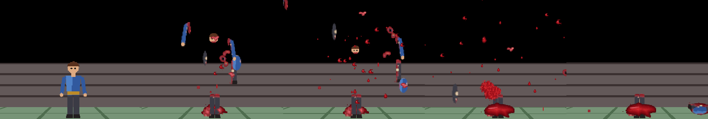
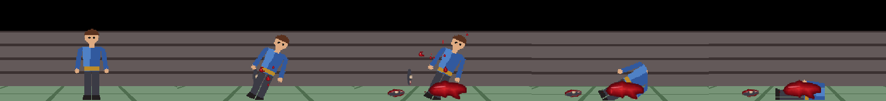

<div align="center">

# Blood and Gore für den Easy FPS Editor

**Blutspritzer, fliegende Körperteile und Gib-Reste für die Gegner deines Easy-FPS-Editor-CE-Projekts.** Die Teile werden aus deinen eigenen Gegner-Sprites geschnitten, jeder Schnitt ist zerfetzt und blutig, nichts ist ein Rechteck.

[](https://github.com/blgymtr/blood-and-gore-script/actions/workflows/ci.yml)
[](LICENSE)

[English](README.md) · **Deutsch** · [Türkçe](README.tr.md)



</div>

## WICHTIG: was das Tool anfasst und was nicht

- Es **liest** Easy-FPS-Editor-Dateien. Es **verändert nie den Editor oder die Engine**: nicht `EasyFPSEditor_CE.exe`, nicht `Game.exe`, keine `.dll`, nichts im Editor-Ordner, nicht das `Manual`, kein anderes Projekt. Jeder Schreibpfad wird aufgelöst (Links verfolgt) und abgelehnt, wenn er außerhalb des gewählten Projektordners liegt. Programmdateien werden auch im Projekt abgelehnt.
- **Standardmäßig Probelauf.** `install` und `uninstall` zeigen nur den vollständigen Plan und schreiben nichts. Dateien ändern sich nur mit `--apply`.
- **Erst Sicherung.** Vor jedem Schreiben wird jede betroffene Datei nach `<Projekt>/bloodgore_backup/<Zeitstempel>/files/` kopiert, mit `manifest.json`. Schlägt etwas fehl, wird das Projekt automatisch zurückgesetzt.
- **Uninstall stellt die Originale byteidentisch wieder her** und löscht nur Dateien, die das Tool selbst erstellt hat (Protokoll in `bloodgore_backup/state.json`).
- **Es verweigert die Ausführung, solange der Editor oder `Game.exe` dieses Engine-Ordners läuft**, und prüft gesperrte Dateien. Schließe beides vorher.
- Sichere dein Projekt vor dem ersten `--apply` zusätzlich (Versionsverwaltung oder Kopie).

## Was es macht

Für jeden Gegner (Sprite-Gegner mit `.states`-Datei oder Editor-Standard):

1. **Liest den Körper** aus der Alpha-Silhouette: Kopf, Hals, Schultern, Arme, Hüfte, Beinspalt, Blickrichtung, Größe, Skalierung. Figuren ohne klaren Kopf und Beine gelten als Kreatur.
2. **Schneidet Teile aus deinen Pixeln:** Kopf, Rumpf, linker und rechter Arm, linkes und rechtes Bein, dazu 3 bis 6 zerfetzte Fleischbrocken (Kreaturen bekommen unregelmäßige Brocken). Schnittlinien sind gekrümmt und gezackt, jede Schnittstelle hat einen runden blutigen Stumpf, an Gliedern mit Knochenansatz. Kanten werden in 4-facher Auflösung gezeichnet und heruntergerechnet (Kantenglättung).
3. **Zeichnet Blut per Code:** Tropfen, Streifen, Klumpen, Nebel, Spritzer, Pfützen. Töne werden synthetisiert. Keine fremde Grafik, keine Aufnahmen.
4. **Ergänzt die `.states`-Datei** (oder erzeugt eine vollständige aus der Basisvorlage des Handbuchs):
   - `HURT`: zusätzliches Blut je nach Gore-Stufe.
   - `DEATH` liest `LASTDAMAGE` und `MAXHP`: ein **großer Treffer zerfetzt den Körper**, ein **mittlerer reißt ein Glied ab** (zufällig, mit Stumpfspritzer), ein kleiner gibt mehr Blut und eine Pfütze.
   - Gelandete Teile bleiben als kleine Dekorationen liegen.
5. Die eigenen Frames und Zeiten des Gegners bleiben unberührt; es werden nur Zeilen eingefügt.



## Installation

Voraussetzungen: Python 3.9+, `pip install -r requirements.txt` (numpy, opencv-python).

```
python bloodgore.py scan    --project "C:\...\EasyFPSEditor_CE\Projects\MeinSpiel"
python bloodgore.py install --project "C:\...\Projects\MeinSpiel"             # Probelauf, schreibt nichts
python bloodgore.py install --project "C:\...\Projects\MeinSpiel" --apply     # installiert wirklich (Editor und Game.exe zu)
```

Danach das Projekt im Editor öffnen, **Build > Test Game**, und einen Gegner hart treffen (Schrotflinte, Explosion).

Rückgängig machen:

```
python bloodgore.py uninstall --project "C:\...\Projects\MeinSpiel" --apply
```

### Befehle

| Befehl | Wirkung |
|---|---|
| `scan --project P` | Nur lesen. Listet Gegner, Frames, Bildgröße, Skalierung, Radius, `.states` vorhanden, erkannte Körperaufteilung. |
| `install --project P [--gore 0-4] [--enemies a,b] [--apply]` | Probelauf ohne `--apply`. Bei neuer Stufe wird die alte Installation zuerst zurückgenommen. |
| `uninstall --project P [--apply]` | Probelauf ohne `--apply`. |
| `preview --project P --enemy X --out blatt.png` | Zeichnet Teile und Partikelbilder in ein Kontaktblatt, schreibt nichts ins Projekt. |

Optionen: `--engine`, `--gib-threshold`, `--tear-threshold`, `--no-decorations` (nur Partikel), `--no-sound`, `--seed`.

### Gore-Stufen

0 nur Engine-Blut (entfernt die Installation), 1 niedrig, 2 normal (Standard), 3 hoch, 4 extrem. Sie steuern Tropfenzahl, Brockenzahl und die Schwellen für Zerfetzen und Abreißen.

## Grenzen

- Nur Sprite-Gegner; 3D-Modell-Gegner werden übersprungen.
- Gegner ohne `.states` bekommen eine erzeugte Datei im 13-Frame-Basislayout; bei anderer Frameanzahl wird proportional geteilt, bitte Animation prüfen.
- Beim Abreißen bleibt der normale Leichen-Sprite (die Engine kann Sprites nicht zusammensetzen).
- In der Engine (1.10.5) wird Partikel-Blut nicht vom Schützen weggerichtet, sondern in alle Richtungen gespritzt.
- Gelandete Teile und Pfützen sind Dekorationen; sie werden über die eigenen Klassen des Editors in `Decorations.dat` eingetragen (Windows, 32-Bit-PowerShell). Sonst gibt das Tool eine Schritt-für-Schritt-Anleitung aus und arbeitet im Nur-Partikel-Modus.

## Tests

`python -m unittest discover -s tests -v` (synthetisches Projekt, Rechteck-Prüfung, Sicherheitsregeln).

## Lizenz

MIT, siehe [LICENSE](LICENSE).
