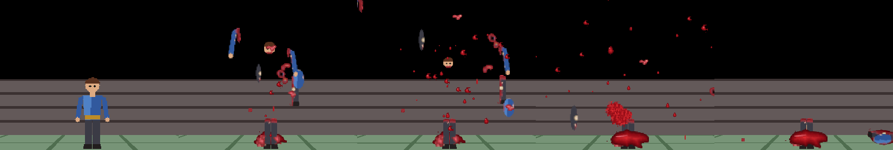
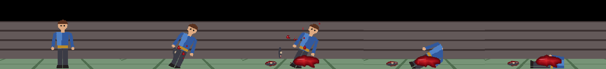
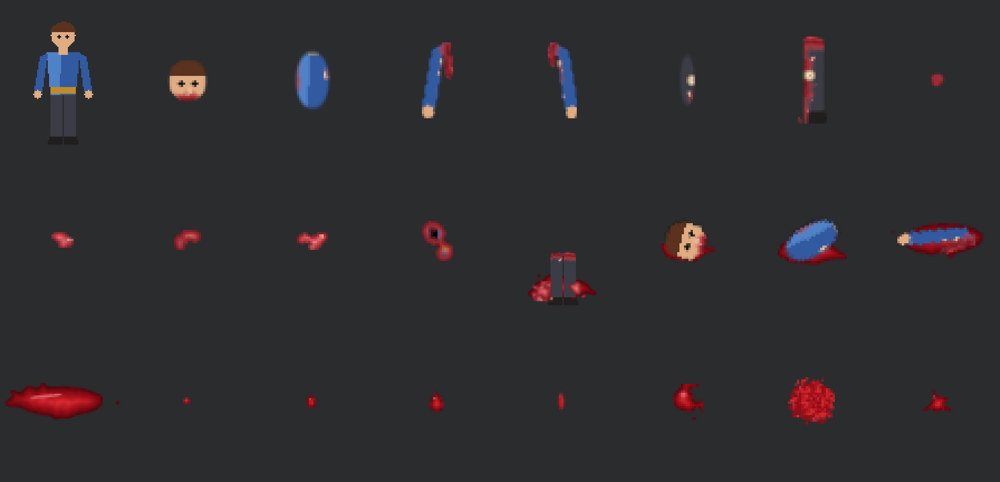

<div align="center">

# Blood and Gore for Easy FPS Editor

**Blood sprays, flying body parts and gib remains for the enemies of your Easy FPS Editor CE project.** The parts are cut from your own enemy sprites, every cut is torn and bloody, nothing is a rectangle.

[](https://github.com/blgymtr/blood-and-gore-script/actions/workflows/ci.yml)
[](LICENSE)

**English** · [Deutsch](README.de.md) · [Türkçe](README.tr.md)



</div>

## CRITICAL: what this tool will and will not touch

- It **reads** Easy FPS Editor files. It **never modifies the editor or the engine**: not `EasyFPSEditor_CE.exe`, not `Game.exe`, not any `.dll`, nothing in the editor folder, not the `Manual`, not another project. Every write path is resolved (links followed) and refused when it is outside the one project folder you select. Program files (`.exe`, `.dll`, scripts) are refused even inside the project.
- **Dry run by default.** `install` and `uninstall` only print a full plan and write nothing. Files change only with `--apply`.
- **Backups first.** Before anything is written, every file the tool will touch is copied to `<project>/bloodgore_backup/<timestamp>/files/` and a `manifest.json` is saved next to it. If anything fails halfway, the project is restored from that backup automatically.
- **Uninstall restores the originals byte for byte** and deletes only the files the tool created (it keeps a record in `bloodgore_backup/state.json`). Files you changed after the install are left alone or cleaned line by line, never overwritten blindly.
- **It refuses to apply while the editor or `Game.exe` of that engine folder is running**, and it checks for locked files. Close both first: the editor would otherwise overwrite or lose these changes.
- Keep your project under version control or copied before the first `--apply`. The backups are a safety net, not a replacement.

## What it does

For every enemy it finds (sprite enemies with a `.states` file or the editor's defaults):

1. **Reads the body** from the sprite's own alpha silhouette: head, neck, shoulders, arms, hips, leg gap, facing, size, scale. A figure with no clear head and legs is treated as a creature.
2. **Cuts parts from your pixels:** head, torso, left and right arm, left and right leg, plus 3 to 6 torn flesh chunks (creatures get Voronoi-like irregular chunks instead). Cut lines are warped, curved and jagged. Each cut has a rounded bloody stump with a bone hint on limbs. Edges are drawn at 4x and averaged down, so they are anti-aliased.
3. **Draws blood by code:** round and teardrop drops, streaks, clots, mist and splats, floor pools. Sounds are synthesized. No outside art or recordings.
4. **Patches the enemy's `.states` file** (or writes a full one from the manual's basic enemy template when the enemy has none):
   - `HURT`: extra blood, scaled by the gore level.
   - `DEATH` reads `LASTDAMAGE` and `MAXHP`: a **big hit gibs the body** (all parts and chunks fly, heavy blood, the body is replaced by a remains sprite: the torn lower body in a pool), a **medium hit tears off a limb** chosen at random with a stump spray, a small hit gets extra blood and a floor pool.
   - Parts that land stay on the floor as small decorations.
5. Keeps the enemy's own frames and timings. Only lines are inserted; nothing of yours is rewritten.



*Medium hit: the normal death animation plays, a limb flies off and lies on the floor, a pool spreads. Screenshots show a synthetic test enemy in a copy of the editor's NewProject, no overlay.*



*`preview` contact sheet of the synthetic test figure: sprite, head, torso, arms, legs, chunks, remains, lying parts, pool and the shared blood sprites.*

## Install

Requirements: Python 3.9 or newer, and `pip install -r requirements.txt` (numpy, opencv-python).

```
python bloodgore.py scan    --project "C:\...\EasyFPSEditor_CE\Projects\MyGame"
python bloodgore.py install --project "C:\...\Projects\MyGame"                 # dry run, writes nothing
python bloodgore.py install --project "C:\...\Projects\MyGame" --apply         # really installs (editor and Game.exe closed)
```

Then open the project in the editor and use **Build > Test Game**. Shoot an enemy hard (shotgun, explosion) to see the gib, and with lighter weapons to see the spray and limb tears.

Undo it at any time:

```
python bloodgore.py uninstall --project "C:\...\Projects\MyGame" --apply
```

### Commands

| Command | What it does |
|---|---|
| `scan --project P` | Read only. Lists every enemy: name, sprite frames, image size, scale and radius from `Enemies.dat`, whether it has a `.states` file, detected head/torso/legs split and facing. |
| `install --project P [--gore 0-4] [--enemies a,b] [--apply]` | Dry run unless `--apply`. Re-running with another level first reverts the previous install. |
| `uninstall --project P [--apply]` | Dry run unless `--apply`. Restores the originals, removes created files. |
| `preview --project P --enemy X --out sheet.png` | Renders the cut parts and particle images into a contact sheet. Writes nothing in the project. |

Options: `--engine <folder with EasyFPSEditor_CE.exe>` (found automatically for `.../Projects/<Name>`), `--gib-threshold` and `--tear-threshold` (share of the enemy's max health that one hit must reach), `--no-decorations` (particles only), `--no-sound`, `--seed N` (another random look).

### Gore levels

| Level | Meaning | Hurt drops | Gib at a hit of | Limb tear at |
|---|---|---|---|---|
| 0 | only the engine's own blood (removes the install) | 0 | never | never |
| 1 | low | 4 | 100% of max health | never |
| 2 | normal (default) | 8 | 80% | 40% |
| 3 | high | 14 (+ mist) | 60% | 25% (head too) |
| 4 | extreme | 20 (+ mist) | 40% | 15% (head too) |

## How it works

**Detection.** The standing frame (the first frame of `IDLE`, else frame 0) is reduced to a silhouette. The row widths give the neck (a narrow row between a wider head and wider shoulders) and the leg gap (two runs in the middle of the lower body that last to the feet). The torso core columns between the neck and the hip separate the arms; when the arms hug the body the split is by proportion. Everything is scaled by the enemy's `Scale` and the sprite size, so a tiny critter and a giant both get fitting parts.

**Engine facts the FSM relies on** (measured in Easy FPS Editor CE 1.10.5 with a synthetic test enemy; they explain some choices):

- `CUSTOMPARTICLE` with id N shows `Custom(N-1).png`. To be safe with either numbering, every particle image is stored in two neighbouring files and the second id is used. New particle files are numbered after your highest existing `CustomN.png`; your own files are never touched.
- Particle images must be square. Particle size in world units is image pixels x scale; sprites and decorations are pixels x scale x 0.4, so parts use scale = enemy scale x 0.4 and look as big as in the body.
- In the FSM, positions are (north, up, east) and velocities (east, up, north), in units and units per second. Particles are not rotated toward the player, so blood **cannot be aimed away from the shooter**; it is sprayed in all directions.
- Gravity acceleration is 233.5 x the gravity argument. Particles pass through the floor, so each lifetime is set to the landing time.
- A zero delay on the first frame of a looping state hangs the engine, so inserted states never use it.
- Frame delay applies to the previous frame, the first line of a state is ignored (so it is always `NONE`), keywords are case sensitive, no leading spaces. Variables are all named `bg...` and none starts with another variable's name.

**Decorations.** The lying parts and pools are decorations (`BgEnemyHead`, ...). They are added to `Decorations.dat` through the editor's own classes (32-bit Windows PowerShell loads the editor exe read only; the project's `.dat` files are backed up first and saved by the editor's code). If that is not possible (not Windows, editor folder not found) the tool prints step by step instructions for the editor UI, writes the sprites to `bloodgore_manual/decorations/`, and everything else still works in particles only mode. Run install again after adding them: it detects them.

## Limits

- Sprite enemies only; 3D model enemies are skipped. Enemies whose `.states` lack mandatory states are skipped and reported.
- Enemies without a `.states` file get a generated one from the manual's basic 13 frame layout. With another frame count the layout is split in the same proportions; check the animation or skip the enemy with `--enemies`.
- A limb tear keeps the normal corpse sprite (the engine cannot compose sprites), so the corpse still has all limbs.
- Parts that fly through walls are not stopped; lying parts can end up inside a wall when an enemy stands next to one.
- Only pools and parts stay on the floor, not every drop.

## FAQ and troubleshooting

**The game hangs or an enemy vanishes.** Restore with `uninstall --apply`. Causes outside this tool: a gap in your `CustomN.png` numbering (the engine loads Custom files only without gaps; install warns), or non-square particle images you added yourself.

**Install refuses because the editor is running.** Close the editor and `Game.exe`, then run it again.

**Can I change the gore level later?** Yes, run `install --gore N --apply` again. It reverts the previous install first and writes the new one.

**Does it work on my enemy?** Run `scan` and `preview` first; they write nothing in the project.

**Where are my originals?** In `bloodgore_backup/`. Delete that folder only when you do not need to uninstall any more.

**Tests.** `python -m unittest discover -s tests -v` runs everything on a synthetic project built by code, including the never-square checks and the safety rules.

## License

MIT, see [LICENSE](LICENSE). The decoration host script is derived from the author's companion EFPSE Bridge tool (MIT).
