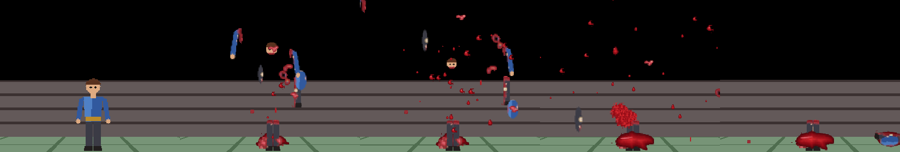
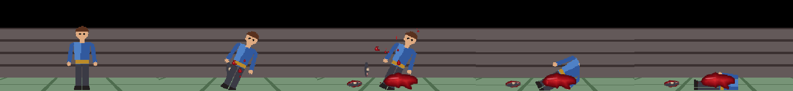

<div align="center">

# Easy FPS Editor için Blood and Gore

**Easy FPS Editor CE projenizdeki düşmanlara kan sıçraması, uçan vücut parçaları ve parçalanma kalıntıları ekler.** Parçalar kendi düşman sprite'larınızdan kesilir, her kesik yırtık ve kanlıdır, hiçbir şey dikdörtgen değildir.

[](https://github.com/blgymtr/blood-and-gore-script/actions/workflows/ci.yml)
[](LICENSE)

[English](README.md) · [Deutsch](README.de.md) · **Türkçe**



</div>

## ÖNEMLİ: araç neye dokunur, neye dokunmaz

- Easy FPS Editor dosyalarını **okur**. **Editöre veya motora asla dokunmaz**: `EasyFPSEditor_CE.exe`, `Game.exe`, hiçbir `.dll`, editör klasöründeki hiçbir şey, `Manual`, başka bir proje. Her yazma yolu çözülür (bağlantılar izlenir) ve seçtiğiniz proje klasörünün dışındaysa reddedilir. Program dosyaları proje içinde bile reddedilir.
- **Varsayılan prova modudur.** `install` ve `uninstall` yalnızca planı yazdırır, hiçbir şey yazmaz. Dosyalar sadece `--apply` ile değişir.
- **Önce yedek.** Yazmadan önce dokunulacak her dosya `<proje>/bloodgore_backup/<zaman damgası>/files/` içine kopyalanır, yanına `manifest.json` yazılır. Yarıda hata olursa proje otomatik geri yüklenir.
- **Uninstall orijinalleri bayt bayt geri yükler** ve yalnızca aracın kendi oluşturduğu dosyaları siler (kayıt: `bloodgore_backup/state.json`).
- **Bu motor klasörünün editörü veya `Game.exe` çalışırken uygulamayı reddeder**, kilitli dosyaları da kontrol eder. Önce ikisini de kapatın.
- İlk `--apply` öncesi projenizi ayrıca yedekleyin.

## Ne yapar

Bulduğu her düşman için (`.states` dosyalı ya da editör varsayılanlı sprite düşmanlar):

1. Sprite'ın alfa siluetinden **gövdeyi okur**: kafa, boyun, omuz, kollar, kalça, bacak aralığı, bakış yönü, boyut, ölçek. Net kafa ve bacağı olmayan şekiller yaratık sayılır.
2. **Parçaları kendi piksellerinizden keser:** kafa, gövde, sol ve sağ kol, sol ve sağ bacak, ayrıca 3 ila 6 yırtık et parçası (yaratıklara düzensiz parçalar). Kesik çizgileri eğri ve tırtıklıdır, her kesikte yuvarlak kanlı bir kütük vardır, uzuvlarda kemik izi bulunur. Kenarlar 4 kat büyütülüp küçültülerek yumuşatılır.
3. **Kanı kodla çizer:** damlalar, çizgiler, pıhtılar, sis, sıçramalar, havuzlar. Sesler sentezlenir. Dışarıdan görsel veya kayıt yoktur.
4. **`.states` dosyasını yamar** (yoksa kılavuzun temel düşman şablonundan tam bir dosya üretir):
   - `HURT`: gore seviyesine göre ek kan.
   - `DEATH`, `LASTDAMAGE` ve `MAXHP` okur: **büyük vuruş gövdeyi parçalar**, **orta vuruş rastgele bir uzvu koparır** (kütükten kan fışkırır), küçük vuruş ek kan ve havuz bırakır.
   - Yere düşen parçalar küçük dekorlar olarak kalır.
5. Düşmanın kendi kareleri ve süreleri değişmez; yalnızca satır eklenir.



## Kurulum

Gereksinim: Python 3.9+, `pip install -r requirements.txt` (numpy, opencv-python).

```
python bloodgore.py scan    --project "C:\...\EasyFPSEditor_CE\Projects\Oyunum"
python bloodgore.py install --project "C:\...\Projects\Oyunum"             # prova, hiçbir şey yazmaz
python bloodgore.py install --project "C:\...\Projects\Oyunum" --apply     # gerçekten kurar (editör ve Game.exe kapalı)
```

Sonra projeyi editörde açın, **Build > Test Game** ile deneyin, düşmana sert vurun (pompalı, patlama).

Geri almak için:

```
python bloodgore.py uninstall --project "C:\...\Projects\Oyunum" --apply
```

### Komutlar

| Komut | Ne yapar |
|---|---|
| `scan --project P` | Yalnızca okur. Düşmanları, kareleri, boyutu, ölçeği, yarıçapı, `.states` durumunu, algılanan gövde bölünmesini listeler. |
| `install --project P [--gore 0-4] [--enemies a,b] [--apply]` | `--apply` yoksa prova. Seviye değişince önce eski kurulum geri alınır. |
| `uninstall --project P [--apply]` | `--apply` yoksa prova. |
| `preview --project P --enemy X --out sayfa.png` | Parçaları ve parçacık görsellerini bir sayfaya çizer, projeye yazmaz. |

Seçenekler: `--engine`, `--gib-threshold`, `--tear-threshold`, `--no-decorations` (yalnızca parçacık), `--no-sound`, `--seed`.

### Gore seviyeleri

0 yalnızca motorun kanı (kurulumu kaldırır), 1 düşük, 2 normal (varsayılan), 3 yüksek, 4 aşırı. Damla ve parça sayısını, parçalanma ve uzuv koparma eşiklerini belirler.

## Sınırlar

- Yalnızca sprite düşmanlar; 3D model düşmanlar atlanır.
- `.states` dosyası olmayan düşmana 13 karelik temel düzenle dosya üretilir; kare sayısı farklıysa oranla bölünür, animasyonu kontrol edin.
- Uzuv koparmada normal ceset sprite'ı kalır (motor sprite birleştiremez).
- Motorda (1.10.5) parçacık kanı atıcıdan uzağa yönlendirilemez, her yöne saçılır.
- Yere düşen parçalar ve havuzlar dekordur; editörün kendi sınıflarıyla `Decorations.dat` dosyasına eklenir (Windows, 32 bit PowerShell). Olmazsa araç adım adım yönerge yazdırır ve yalnızca parçacık modunda çalışır.

## Testler

`python -m unittest discover -s tests -v` (kodla üretilmiş sentetik proje, dikdörtgen denetimi, güvenlik kuralları).

## Lisans

MIT, bkz. [LICENSE](LICENSE).
